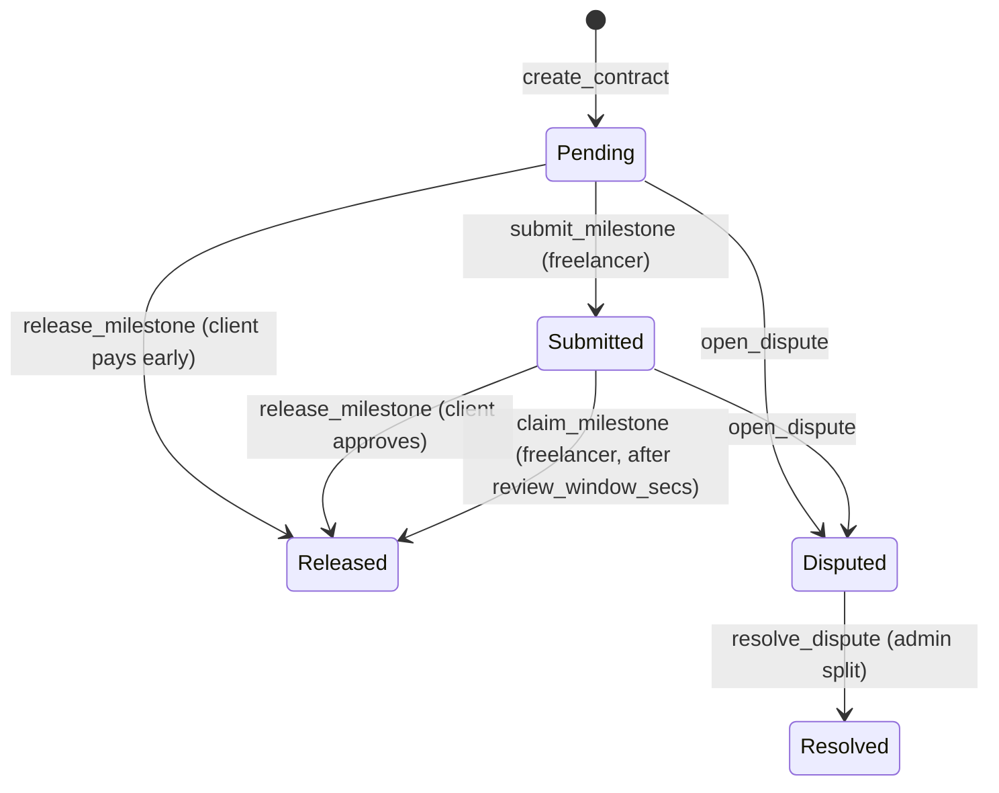

# TalentTrust Contracts

## Live

- Website: https://talenttrust-frontend.vercel.app
- Docs: https://talenttrust-frontend.vercel.app/docs
- API: https://talenttrust-backend.vercel.app (docs at [/docs](https://talenttrust-backend.vercel.app/docs))
- Contract (testnet): [`CCZMIVUBMG5SBC47SDTC32RWLBJ2HW2DCFVWJEOKCH2IFJBZGBKTXK5W`](https://stellar.expert/explorer/testnet/contract/CCZMIVUBMG5SBC47SDTC32RWLBJ2HW2DCFVWJEOKCH2IFJBZGBKTXK5W)

Soroban smart contract for the TalentTrust freelancer escrow protocol on Stellar.
Clients lock payment for a job into escrow, release it milestone by milestone as
work is approved, and either party can raise a dispute that the protocol admin settles.

## Deployments

| Network | Contract | ID | Explorer |
| --- | --- | --- | --- |
| Stellar testnet | escrow | `CCZMIVUBMG5SBC47SDTC32RWLBJ2HW2DCFVWJEOKCH2IFJBZGBKTXK5W` | [stellar.expert](https://stellar.expert/explorer/testnet/contract/CCZMIVUBMG5SBC47SDTC32RWLBJ2HW2DCFVWJEOKCH2IFJBZGBKTXK5W) |

The contract is initialized with admin `GA7TXEBMEPQCLHIYCWDN7RKAO5IMRD2UV7O7TZXMEW6VZUMEXNR4XBB5`.
Machine-readable details are in [deployments/testnet.json](deployments/testnet.json).

## Contract interface (`contracts/escrow`)

| Function | Auth | Description |
| --- | --- | --- |
| `initialize(admin)` | admin | One-time setup |
| `create_contract(client, freelancer, token, milestone_amounts, review_window_secs) -> u64` | client | Create an escrow with up to 20 milestones and a review window (1 hour .. 30 days) |
| `deposit_funds(id, amount)` | client | Transfer tokens into escrow (cannot exceed total) |
| `release_milestone(id, index)` | client | Pay the freelancer for a milestone; accepts `Pending` and `Submitted` |
| `submit_milestone(id, index)` | freelancer | Record delivery, starting the client's review window |
| `claim_milestone(id, index)` | freelancer | Claim a `Submitted` milestone once the review window has elapsed |
| `open_dispute(id, caller)` | client or freelancer | Freeze the escrow pending resolution |
| `resolve_dispute(id, freelancer_bps)` | admin | Split the held balance (basis points to freelancer) |
| `cancel_contract(id)` | client | Refund funds backing `Pending` milestones only, and close |
| `issue_reputation(id, rating)` | client | Rate a completed job (1-5), once |
| `set_paused(bool)` / `is_paused()` | admin / - | Circuit breaker for all mutations |
| `get_contract(id)`, `contract_count()`, `get_reputation(addr)`, `get_admin()`, `version()` | - | Reads |

Status flow: `Created -> Funded -> Completed`, with `Disputed -> Resolved` and `Cancelled` side exits.

### Milestone lifecycle

`Pending -> Submitted -> Released`. A milestone's state is what decides whether the
client can still take the money back: only `Pending` funds are refundable.



`cancel_contract` refunds only the `Pending` milestones. Funds behind a
`Submitted` milestone stay in the contract until the freelancer claims them or a
dispute resolves, which is what stops a client cancelling after delivery. The
full rules are in [docs/escrow/milestone-review-window.md](docs/escrow/milestone-review-window.md).

### Errors

`EscrowError` is part of the public interface: clients map on the numeric code, so
**codes are append-only**. A new variant takes the next free number and is never
inserted in the middle.

| Code | Name | Raised when |
| --- | --- | --- |
| 1 | `AlreadyInitialized` | `initialize` called twice |
| 2 | `NotInitialized` | admin not set |
| 3 | `Unauthorized` | caller is not the admin or a party |
| 4 | `Paused` | a mutation while the circuit breaker is on |
| 5 | `ContractNotFound` | unknown escrow id |
| 6 | `InvalidParties` | client equals freelancer |
| 7 | `InvalidMilestones` | zero milestones, or more than 20 |
| 8 | `InvalidAmount` | non-positive amount, or the milestones sum past `i128::MAX` |
| 9 | `OverFunded` | deposit would exceed the contract total |
| 10 | `InvalidStatus` | the call is not valid in the current status |
| 11 | `MilestoneNotFound` | index out of range |
| 12 | `MilestoneAlreadyReleased` | releasing or submitting a released milestone |
| 13 | `InsufficientFunds` | held funds do not cover the milestone |
| 14 | `InvalidSplit` | `freelancer_bps` above 10 000 |
| 15 | `InvalidRating` | rating outside 1..=5 |
| 16 | `ReputationAlreadyIssued` | rating a job twice |
| 17 | `InvalidReviewWindow` | `review_window_secs` outside 1 hour .. 30 days |
| 18 | `MilestoneNotSubmitted` | `claim_milestone` on a milestone that is not `Submitted` |
| 19 | `ReviewWindowActive` | `claim_milestone` before `submitted_at + review_window_secs` |

### Events

| Topics | Data |
| --- | --- |
| `init` | admin |
| `paused` | `bool` |
| `created`, `id` | (client, freelancer, total) |
| `deposit`, `id` | amount |
| `submit`, `id` | (milestone index, submitted_at) |
| `release`, `id` | (milestone index, amount) |
| `claim`, `id` | (milestone index, amount) |
| `dispute`, `id` | caller |
| `resolved`, `id` | (to_freelancer, to_client) |
| `cancel`, `id` | refunded amount |
| `rep`, `id` | (freelancer, rating) |

## Build and test

```bash
rustup target add wasm32v1-none      # toolchain pinned in rust-toolchain.toml
cargo build --target wasm32v1-none --release
cargo test
```

The wasm is written to `target/wasm32v1-none/release/escrow.wasm`.

## Deploy

```bash
stellar contract deploy --wasm target/wasm32v1-none/release/escrow.wasm \
  --source <key> --network testnet
stellar contract invoke --id <CONTRACT_ID> --source <key> --network testnet \
  -- initialize --admin <ADMIN_ADDRESS>
```

## License

MIT
