# Milestone submission, review window, and auto-release

Closes the gap where the client held unilateral control over every payout, which
made the contract unsafe for the party it exists to protect.

## The hole

Before this change a milestone was a `bool`:

```rust
pub struct Milestone {
    pub amount: i128,
    pub released: bool,
}
```

`released == false` meant "not paid", which covers two very different situations:
*not started* and *delivered, awaiting approval*. The contract could not tell them
apart, so it could not defend the second one.

That made this sequence possible, and it is why the issue exists:

1. The freelancer delivers milestone 0 and sends the work over.
2. The client copies the work.
3. The client calls `cancel_contract` in the same ledger.

`cancel_contract` refunded `funded_amount - released_amount`, and nothing had been
released, so the client got **100% back** and the freelancer got nothing. The only
recourse was to race the client with `open_dispute`, and losing that race is
unrecoverable.

## The state machine

```mermaid
stateDiagram-v2
    [*] --> Pending: create_contract
    Pending --> Submitted: submit_milestone (freelancer)
    Pending --> Released: release_milestone (client pays early)
    Submitted --> Released: release_milestone (client approves)
    Submitted --> Released: claim_milestone (freelancer, after the window)
    Pending --> Disputed: open_dispute
    Submitted --> Disputed: open_dispute
    Disputed --> Resolved: resolve_dispute (admin split)
    Cancelled --> Released: claim_milestone still works
```



`Pending` is the only state whose funds the client can take back. Once a milestone
is `Submitted`, the money backing it is committed to the freelancer and leaves the
escrow only by release, claim, or dispute resolution.

| State | Meaning | Refundable by `cancel_contract` | Claimable |
| --- | --- | --- | --- |
| `Pending` | not delivered | yes | no |
| `Submitted` | delivered, under review | **no** | yes, after the window |
| `Released` | paid | no | no |

## The review window

`create_contract` takes `review_window_secs`, validated to
`MIN_REVIEW_WINDOW_SECS` (1 hour) .. `MAX_REVIEW_WINDOW_SECS` (30 days), and
otherwise returns `InvalidReviewWindow`.

The bounds exist for both sides. Too short and the client cannot meaningfully
review; too long and the auto-release is not worth having. `submit_milestone`
stamps `submitted_at` from the ledger, and `claim_milestone` succeeds once
`now >= submitted_at + review_window_secs`.

The deadline is computed with `checked_add`. On overflow the window is treated as
**not** elapsed, which is the conservative direction: releasing early would take
the money out from under a review that is still running. Real ledger timestamps
are around `1.7e9` and the window is capped at 30 days, so the branch is
unreachable in practice; it exists so the function is total.

## Who can do what

| Call | Caller | Escrow must be | Milestone must be |
| --- | --- | --- | --- |
| `submit_milestone` | freelancer | `Funded` | `Pending` |
| `claim_milestone` | freelancer | not `Disputed` | `Submitted`, window elapsed |
| `release_milestone` | client | `Created` or `Funded` | `Pending` or `Submitted` |
| `cancel_contract` | client | `Created` or `Funded` | refunds `Pending` only |

`claim_milestone` deliberately does **not** require the escrow to still be
`Funded`. A cancelled escrow leaves submitted milestones claimable, which is the
entire point of the submission state: the client cannot cancel their way out of
paying for delivered work. It does refuse while the escrow is `Disputed`, because
the dispute path owns the funds at that point.

It also cannot double-pay after a resolved dispute. `resolve_dispute` pays out
`funded_amount - released_amount` and sets `funded_amount = released_amount`, so
the held balance is zero and any leftover `Submitted` milestone fails the
`InsufficientFunds` check in the shared payout path.

## Accounting

Two invariants hold after every call:

- The contract's token balance equals `funded_amount - released_amount`.
- `submitted_backing(c)` (the sum of `Submitted` milestone amounts) never exceeds
  `funded_amount - released_amount`.

`cancel_contract` refunds
`(funded_amount - released_amount) - submitted_backing(c)` and decrements
`funded_amount` by exactly that, so the custody invariant survives a partial
refund. Tests assert both invariants after every money-moving call.

Note on `submitted_backing`: the sum cannot overflow. `create_contract` validates
that the milestone amounts sum to `total_amount` with `checked_add`, and this is a
sum over a subset of those amounts. It uses `saturating_add` to state that bound
rather than leave a panic path open.

## Errors

Three variants are added, appended after `ReputationAlreadyIssued = 16`. Existing
codes are never renumbered or reused, because the frontend and backend map on
them.

| Code | Name | Raised by |
| --- | --- | --- |
| 17 | `InvalidReviewWindow` | `create_contract` |
| 18 | `MilestoneNotSubmitted` | `claim_milestone` |
| 19 | `ReviewWindowActive` | `claim_milestone` |

`submit_milestone` on an already-`Submitted` milestone returns `InvalidStatus`
rather than a new code: re-submitting would restart the review clock and let the
freelancer postpone review indefinitely, and the existing "not valid in the
current status" code already says that. Submitting a `Released` milestone returns
`MilestoneAlreadyReleased`, which is exact.

## Events

| Topics | Data | Emitted by |
| --- | --- | --- |
| `submit`, `id` | `(index, submitted_at)` | `submit_milestone` |
| `claim`, `id` | `(index, amount)` | `claim_milestone` |
| `cancel`, `id` | refunded amount | `cancel_contract` (now the pending-only figure) |
